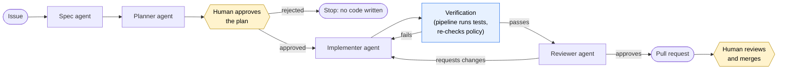

# agentic-sdlc-pipeline

[](https://github.com/Ankita-0607/agentic-sdlc-pipeline/actions/workflows/ci.yml)

A governed multi-agent software delivery pipeline. A team of Claude agents
takes a GitHub issue through **spec → plan → code → tests → review → pull
request**, inside guardrails an engineering organisation can actually sign
off on: policy-as-code, a human approval gate, independent verification, a
tamper-evident audit trail and a hard budget.



Yellow steps are people. The blue step is plain deterministic code. The agents
fill in the stages; they never decide the flow, and nothing merges without a
human.

## Why this exists

Getting an agent to write code is the easy part. The question an engineering
manager has to answer is different: **under what controls would I let agents
change a production codebase, and how would I know those controls work?**

This project is a working answer to that question, small enough to read in an
afternoon:

- What agents may touch is a reviewed file in the repository, not a paragraph in a prompt.
- A named human approves the plan before any code is written, and reviews the pull request after.
- The pipeline re-runs the tests and re-checks the diff itself; it does not take the agent's word for it.
- Every model call, tool call, policy decision and approval is in an audit log that shows if it has been edited.
- An eval suite with hidden acceptance tests measures how often "the pipeline said it was ready" was actually true.

## The controls

| Risk | Control | Enforced in |
|---|---|---|
| Agent edits something it should not (CI config, dependencies, its own policy) | Writable and protected path globs; deny wins; the policy file and `.git` are always protected | [`src/policy/policy.ts`](src/policy/policy.ts) |
| Path tricks (`../`, absolute paths, symlinks out of the repo) | Every model-supplied path is resolved and confined to the workspace | [`src/policy/policy.ts`](src/policy/policy.ts) |
| Agent runs arbitrary commands | There is no shell tool. The only command is the test command named in the policy, and agents cannot pass arguments to it | [`src/agent/tools.ts`](src/agent/tools.ts) |
| Secrets leak to the model or into the code | Unreadable path globs; secret scan on every write and again on the final diff; test process gets a scrubbed environment | [`src/policy/policy.ts`](src/policy/policy.ts), [`src/agent/tools.ts`](src/agent/tools.ts) |
| One agent does everything, unchecked | Least-privilege tool grants per role: only the implementer can write, the reviewer can read and run tests | `roles:` in [`agent-policy.yaml`](agent-policy.yaml) |
| Agents build the wrong thing | A human approves the spec and plan first. The gate can only be waived in the reviewed policy file, never by a command-line flag | [`src/pipeline/pipeline.ts`](src/pipeline/pipeline.ts) |
| Agent claims "tests pass" when they do not | The pipeline runs the tests itself and re-checks the real change set from git | `verify()` in [`src/pipeline/pipeline.ts`](src/pipeline/pipeline.ts) |
| Implementer marks its own homework | A separate reviewer agent sees the spec and the diff, not the implementer's self-report. An approval with a blocking finding attached is treated as a rejection | [`src/pipeline/pipeline.ts`](src/pipeline/pipeline.ts) |
| Runaway loops and cost | Turn limit per agent, rework-round limit, and a token and dollar budget checked before every model call | [`src/llm/usage.ts`](src/llm/usage.ts) |
| "What did the agents actually do?" | Hash-chained JSONL audit log; `asdlc audit verify` detects edits and deletions | [`src/audit/audit.ts`](src/audit/audit.ts) |
| CI token exposed to agent-written code | The job that runs agent-written tests holds a read-only token; a separate job re-checks the patch and opens the pull request | [`agent-pipeline.yml`](.github/workflows/agent-pipeline.yml) |

The threat model, including what these controls do **not** cover, is in
[docs/governance.md](docs/governance.md).

## Policy as code

Each repository the pipeline works on carries an `agent-policy.yaml`. This is
the one that governs this repository:

```yaml
workspace:
  writable:
    - "examples/sample-service/src/**"
    - "examples/sample-service/test/**"
  protected:
    - ".github/**"
    - "src/**"
    - "**/package.json"
    - "**/agent-policy.yaml"
  unreadable:
    - "**/.env*"

limits:
  max_files_changed: 8
  max_diff_lines: 400
  max_rework_rounds: 2

budget:
  max_cost_usd: 5

commands:
  test: "npm run test:sample --silent"   # the only command agents can trigger

gates:
  plan_approval: required                # a named human approves before code is written

roles:
  planner:     [list_files, read_file, search_code]
  implementer: [list_files, read_file, search_code, write_file, edit_file, run_tests]
  reviewer:    [list_files, read_file, search_code, run_tests]
```

Changing what agents may do means changing this file in a pull request, with
the same review as any other change.

## Try it

Requires Node.js 20 or later.

```bash
git clone https://github.com/Ankita-0607/agentic-sdlc-pipeline.git
cd agentic-sdlc-pipeline
npm install
```

**Without an API key** (free, about ten seconds). Runs the test suite and the
offline evals, which drive the whole pipeline with a scripted stand-in for the
model:

```bash
npm test
npm run eval:offline
```

**With an API key**, on a scratch branch of this repository:

```bash
export ANTHROPIC_API_KEY=...
git checkout -b try-it
npm run asdlc -- run --issue examples/issues/001-p90-turnaround.md
```

The agents write a spec and a plan and print them. You approve or reject on
the terminal. If you approve, they implement on a new `agent/...` branch and
print the run report. The audit log, plan and report are saved under
`.agent-runs/<run id>/`:

```bash
npm run asdlc -- audit verify .agent-runs/<run id>/audit.jsonl
```

**On GitHub**, with `ANTHROPIC_API_KEY` set as a repository secret:

1. Open an issue and add the label `agent:plan`. The agents comment with a spec and a plan.
2. A collaborator comments `/approve`. The agents implement, verify and review.
3. A pull request appears, with the run report as its description. A human reviews and merges.

## Evals

[`evals/`](evals) holds issues for the sample service, each with acceptance
tests the agents never see. The harness runs the full pipeline on a fresh copy
of the service, then drops the hidden tests in. That separates "the pipeline
finished and called the change ready" from "the change is correct", and counts
the gap as **escaped defects**: changes the pipeline's own verification and
review approved that the hidden tests reject.

| Mode | Command | What it tells you |
|---|---|---|
| Offline | `npm run eval:offline` | The harness and hidden tests are sound: the reference solutions pass, the unmodified service fails. Runs in CI on every push. |
| Live | `npm run eval` or the **Evals (live)** workflow | How a real model performs: success rate, escaped defects, rework rounds, tokens and cost per task. |

Live results are written to `evals/results/live.md`.

<!-- LIVE_RESULTS -->
_No live run has been recorded in this repository yet._
<!-- /LIVE_RESULTS -->

## How it is built

- **TypeScript, Node.js.** Claude through the official [`@anthropic-ai/sdk`](https://www.npmjs.com/package/@anthropic-ai/sdk), with adaptive thinking, prompt caching and streaming.
- **A hand-written agent loop** ([`src/agent/loop.ts`](src/agent/loop.ts), about 150 lines) rather than a framework, because the governance hooks live between turns: budget check before each model call, policy check and audit record around each tool call.
- **Structured hand-offs.** Each stage ends with a `submit_*` tool call validated against a Zod schema ([`src/types.ts`](src/types.ts)), so stages exchange typed artifacts, not prose.
- **The model behind an interface** ([`src/llm/client.ts`](src/llm/client.ts)). Tests and offline evals plug in a scripted implementation, which is how more than 80 tests cover gates, rework loops and failure paths without an API key.

```
src/
  policy/     policy schema and enforcement
  audit/      hash-chained audit log
  agent/      the agent loop and the tools agents can call
  agents/     the four roles and their prompts
  pipeline/   orchestrator, approval gates, git workspace, run report
  llm/        Claude client, usage and cost tracking, scripted test double
  github.ts   issues, comments and pull requests through the gh CLI
  cli.ts      asdlc plan | build | run | audit verify | policy check
evals/        eval tasks, harness and results
examples/     the sample service the agents work on, and example issues
docs/         governance notes and decision records
```

Design decisions are recorded in [docs/adr](docs/adr).

## Limitations

- The test command runs agent-written code on the same machine as the pipeline. The environment is scrubbed and the CI token is read-only, but this is not a sandbox. See [docs/governance.md](docs/governance.md).
- Agents rewrite or patch whole files; there is no semantic merge. It suits small, well-scoped issues, which is also where agent output is easiest to review.
- One repository, one issue at a time. No dependency changes: `package.json` is protected by default, on purpose.
- The reviewer agent reduces, but does not remove, the need for human review. The eval suite exists to measure by how much.

## Development

This project was built with AI assistance (Claude Code). Issues and
suggestions are welcome.

MIT licensed.
